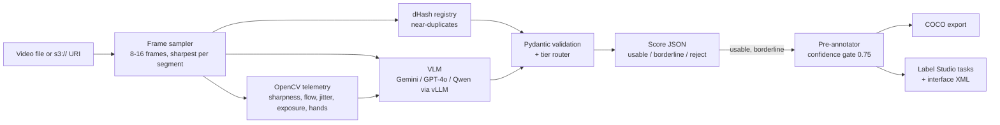

# Locara VLM pipeline: quality scoring and pre-annotation for ego-centric video

## What it is

My submission for the Locara Labs ML Engineer assignment. It scores ego-centric clips on 7 quality dimensions with a vision-language model (VLM) and OpenCV measurements, and routes each clip to `usable`, `borderline` or `reject`.
It then pre-labels the clips that pass in a robotics taxonomy, gated by confidence, and exports COCO and Label Studio tasks for human review.
Design answers (Q1 to Q7) are in [DESIGN_DOC.md](DESIGN_DOC.md). Scale and cost (Q8 to Q11) are in [INFRA.md](INFRA.md) and [cost_model_2M_hours.csv](cost_model_2M_hours.csv).

## Setup

Requires Python 3.10+. The final code was tested on Python 3.13.

```bash
python -m venv .venv && source .venv/bin/activate      # Windows: .venv\Scripts\activate
pip install -r requirements.txt
```

No API key is needed for the offline run.

## Quick start (offline)

The `offline` provider is not a VLM. It scores from the OpenCV measurements alone, so the pipeline runs without keys and a VLM has a baseline to beat. Every record states its provider in `meta.provider`.

Use the committed clips in data/synthetic/; regenerating them without ffmpeg gives different files, so the Q4 numbers will not match.

```bash
python score_videos.py data/synthetic --provider offline -o sample_outputs/scored_videos_batch.json
python pre_annotate.py --scores sample_outputs/scored_videos_batch.json --provider offline
python evaluate_pipeline.py --scores sample_outputs/scored_videos_batch.json \
    --truth data/synthetic/ground_truth.json \
    --out sample_outputs/precision_recall_report.json \
    --markdown sample_outputs/precision_recall_report.md
python scripts/cost_model.py          # writes cost_model_2M_hours.csv
```

These are the commands that produced `sample_outputs/`. The clips themselves come from `python tests/generate_synthetic_clips.py --out data/synthetic`.

## Running with Gemini

```bash
cp .env.example .env      # then set VLM_PROVIDER=gemini and GEMINI_API_KEY
python score_videos.py data/synthetic --provider gemini --workers 2 -o scores_gemini.json -v
```

`--workers 2` suits free-tier rate limits. `--provider openai` and `--provider vllm` work the same way, and `.env.example` lists their settings. None of them was run against a real model for this submission (see Known limitations).

API keys are read only from the environment or `.env`. They never go into settings objects, logs or output JSON, and provider error text is redacted before it is logged or stored. The vLLM client sends `VLLM_API_KEY` if you set one and a placeholder otherwise, never your OpenAI key.

How model failures are handled:

- A rejected key (401, 403, or Gemini's 400 for an invalid key) is never retried. The batch stops after that one call, the other clips are marked `skipped: authentication failed`, and the exit code is 2. Calls run one at a time until the model first answers, so a bad key costs one request whatever `--workers` is.
- A 429 is retried with backoff, waiting at least as long as `Retry-After` asks, up to 120 s. Timeouts and 5xx are retried with backoff.
- A reply that is not valid JSON gets one retry, then only that clip fails.

## Batch and S3

```bash
python score_videos.py clip.mp4 -o scores.json                       # one video
python score_videos.py data/synthetic --workers 8 -o scores.json     # a folder
python score_videos.py s3://my-bucket/uploads/2026/11/06/ -o scores.json
python score_videos.py @videos.txt -o scores.json    # one path or S3 URI per line
```

One output record (required keys first; `meta` is extra, and `--no-meta` drops it):

```json
{"video_id": "...", "processed_at": "2026-11-06T10:41:12Z", "frame_count_sampled": 12,
 "scores": {"egocentric_framing": {"score": 1, "reasoning": "...", "confidence": 0.91}, "...": {}},
 "tier": "borderline", "tier_confidence": 0.75,
 "meta": {"provider": "offline", "composite_score": 4.7, "hard_gates_failed": [], "telemetry": {}}}
```

A video that cannot be read or scored gets a record with `video_id`, `source` and `error`, and the rest of the batch carries on. `score_videos.py` exits 1 if any video failed and 2 if it could not start, for example on a missing input or API key.

`video_id` comes from the content. A local file is named by the SHA-256 of its bytes, and an S3 object by its bucket, key, ETag and size, so nothing is downloaded just to name it. To use the capture app's ID instead, give the `@list` file a `path,video_id` header. `--hash-registry file.json` remembers clips between runs: scoring the same file from the same place is a re-run, and the same content from anywhere else is a duplicate.

S3 objects stream into scoring. Up to `--download-workers` (default 4) download at once, and at most 16 videos are in progress, which bounds memory and disk. The duplicate check still runs in input order, so the earlier copy is always the original. Each download is deleted once scored unless you pass `--keep-cache`. Objects over `S3_MAX_DOWNLOAD_MB` (default 500) are refused before download, and a key containing `..` cannot leave the cache folder.

Videos decode in worker processes, because a thread stuck inside FFmpeg cannot be stopped. A decode that takes longer than `--decode-timeout` (default 120 s) is killed and recorded as an error, and a decoder crash fails only that clip. Only the video extensions in `src/config.py` are opened, and clips over 8K per frame or 500,000 decoded frames are refused.

## Pre-annotation

```bash
python pre_annotate.py --scores sample_outputs/scored_videos_batch.json --provider gemini
```

Rejected clips are skipped. Labels at 0.75 or above (`--threshold`) become pre-labels, labels from 0.50 to 0.75 are marked for human verification, and lower ones are dropped. The outputs go to `sample_outputs/coco_annotations_sample.json` and `sample_outputs/label_studio_tasks_sample.json` (`--coco`, `--label-studio`). Import the tasks into a Label Studio project that uses `src/annotation/label_studio_interface.xml`.

The script trusts the video paths in the scores file unless you pass `--videos`, which limits it to files directly inside that folder. Use `--videos` for a scores file you did not produce yourself.

## Evaluation

```bash
python evaluate_pipeline.py --scores sample_outputs/scored_videos_batch.json \
    --truth data/synthetic/ground_truth.json \
    --out sample_outputs/precision_recall_report.json \
    --markdown sample_outputs/precision_recall_report.md
```

The positive class is the defect. The report gives per-dimension precision, recall and F1, exact and within-1 accuracy, the tier confusion matrix, reject-detection precision and recall, auto-accept precision, each failure with the scorer's reasoning, and a threshold sweep for calibrating the routing (DESIGN_DOC Q5). Compare prompt versions (Q3) by scoring with `--prompt-version v1`, `v2` or `v3`.

Synthetic clips test the plumbing, not the model. To measure a VLM on real footage:

1. Record 15 to 20 clips of 10 to 60 s with a phone on your head or chest, including deliberate failures: a shaky walk, a dark room, the phone on a table, no hands, and an exact re-upload.
2. Put them in `data/real/` (git-ignored) and run `python score_videos.py data/real --provider gemini -o data/real/scores.json`.
3. Make the labelling sheet: `python evaluate_pipeline.py --make-template data/real/scores.json --template-out labels.csv`.
4. Fill in `labels.csv` by watching each clip, without looking at the scores.
5. Run `python evaluate_pipeline.py --scores data/real/scores.json --truth labels.csv --markdown report.md`.

## Tests

```bash
pytest -q
```

386 tests: 384 pass and 2 skip on Python 3.13 on Windows. Provider SDKs are mocked, so no network or key is needed. One test skips without ffmpeg, and one skips on Windows without Developer Mode because it creates a symlink.

## Architecture



```
locara-vlm-pipeline/
  score_videos.py          Part A CLI: one video, a folder, s3:// URIs or prefixes, @list.txt
  pre_annotate.py          Part B CLI: scores JSON -> COCO + Label Studio tasks
  evaluate_pipeline.py     Q4: precision/recall vs ground truth; Q5 threshold sweep
  src/config.py            providers, routing weights and thresholds, sampling limits
  src/cli.py               shared CLI error handling and file helpers
  src/redact.py            keeps credentials out of logs, errors and output
  src/schemas/             scoring schema (exact required JSON), taxonomy, downstream contracts
  src/scorer/              frame_sampler, decode_pool, dedup, prompts (v1-v3), vlm_client,
                           provider_errors, quality_scorer, s3_io
  src/annotation/          pre_annotator, exporters, label_studio_interface.xml
  scripts/cost_model.py    Q8/Q11 cost model -> cost_model_2M_hours.csv
  scripts/benchmark_vllm.py  measures GPU throughput for the cost model (needs a vLLM server)
  tests/                   synthetic clip generator + 386 tests
  data/synthetic/          the 10 committed clips and ground_truth.json
  sample_outputs/          outputs of the offline run
```

## Sample outputs

All five files come from the offline OpenCV baseline (`--provider offline`), not from Gemini, produced by the Quick start commands.

- `scored_videos_batch.json`: offline. One score record per clip for the 10 synthetic clips, with reasoning and telemetry.
- `coco_annotations_sample.json`: offline. COCO export for the 5 clips that were not rejected; hand states and viewpoints only.
- `label_studio_tasks_sample.json`: offline. Label Studio import tasks for the same 5 clips.
- `precision_recall_report.json`: offline. The Q4 evaluation against `data/synthetic/ground_truth.json`, with failures and the threshold sweep.
- `precision_recall_report.md`: offline. The same tables in Markdown.

## Known limitations

- The sample outputs and the Q4 numbers come from the offline OpenCV baseline, not from a VLM.
- The Gemini client is implemented and unit-tested, but it was not run for this submission. No Gemini result is reported anywhere in this repo. The same holds for the OpenAI and vLLM clients.
- This reproduces the Q4 numbers with Gemini:

  ```bash
  python score_videos.py data/synthetic --provider gemini --workers 2 -o sample_outputs/scored_videos_batch.json -v
  python evaluate_pipeline.py --scores sample_outputs/scored_videos_batch.json --truth data/synthetic/ground_truth.json --out sample_outputs/precision_recall_report.json --markdown sample_outputs/precision_recall_report.md
  ```

- The 10 clips are synthetic, with ground truth designed into them, so the numbers check the pipeline. They do not measure a model on real footage.
- The tests ran on Windows with Python 3.13 only. Linux, macOS and other Python versions were not run on the final code.
- The Q4 numbers depend on the encoder. The committed clips were encoded with ffmpeg 9.0.2 and libx264. Another build, or no ffmpeg, gives different individual scores. Tiers stayed the same across the three encodes I tried.
- `tier_confidence` can differ by 0.01 between Python versions when a mean lands exactly on a rounding edge, because `sum()` on floats changed in Python 3.12. The outputs here come from Python 3.13.
- Python 3.10 uses `google-genai` 2.33.0, because 3.0.0 needs 3.11.
- With `--hash-registry`, moving a file makes it look like a re-upload, because the origin is its full path.
- An exact copy shares its original's `video_id`, so one output can hold two records with the same ID.
- Errors other than a rejected key are retried per clip even when retrying cannot help, such as a wrong model name or OpenAI's `insufficient_quota`.
- If calls keep failing before the model first answers, the batch stays one clip at a time, so an outage runs slower.
- `QualityScorer` used directly has no decode timeout unless you pass `decode_timeout`, and a script that does needs an `if __name__ == "__main__":` guard. All the CLIs set it.
- The hang and crash tests use a fake sampler. I don't have a file that really hangs FFmpeg.
- `scripts/benchmark_vllm.py` repeats the same URI concurrently, which can fail on Windows for S3 inputs. Use local files with it.

## How this was built

<!-- AUTHOR: write 3 to 5 lines in your own words: what you designed,
which tools you used (including any AI coding assistant), what you
tested and fixed yourself. -->
